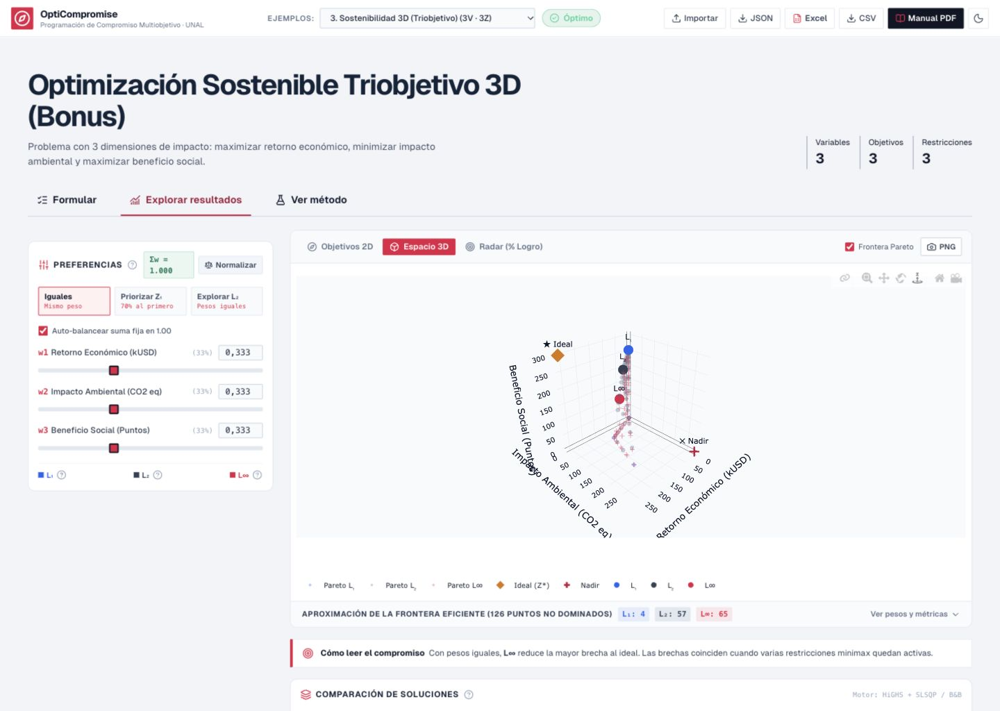

# Guía de la interfaz actual

## Formular un modelo

1. Elige uno de los seis ejercicios precargados o **+ Nuevo Modelo en Blanco** en la barra superior. Desde la misma barra puedes descargar **Plantilla Excel (.xlsx)** / **CSV**, **Ejemplo Excel (Papel)** / **CSV**, abrir **Guía Docente PDF** o **Manual PDF**, e **Importar** archivos `.json`, `.xlsx` o `.csv`.
2. En **Formular**, define las variables (tipo continua ℝ, entera ℤ o binaria {0,1} y cotas), agrega dos o más objetivos (Max/Min) y registra las restricciones con `≤`, `≥` o `=`.
3. Puedes editar coeficientes en **Modo Tabla** o escribir ecuaciones directamente en **Modo Algebraico**. Si editas en texto, recuerda pulsar **Aplicar Ecuaciones y Resolver**; mientras exista un **Borrador sin aplicar**, las vistas de resultados y la exportación permanecen bloqueadas para evitar inconsistencias. La **Vista Previa Matemática (LaTeX / KaTeX)** muestra en vivo el modelo que recibe el motor.
4. Si el modelo es infactible, revisa qué restricciones y cotas son incompatibles. Si está no acotado, revisa qué objetivo puede mejorar indefinidamente.

## Explorar e interpretar

1. En **Preferencias**, elige un perfil rápido o mueve los deslizadores para expresar la importancia de cada objetivo. Con *Auto-balancear suma fija en 1.00* la suma se conserva automáticamente; si lo desactivas y $\Sigma w \neq 1.00$, utiliza el botón **Normalizar pesos (1.00)** (o **Normalizar**).
2. En **Explorar resultados**, identifica en **Objetivos 2D** el punto ideal, el nadir aproximado, las curvas de isodistancia, la zona factible y las tres soluciones. Elige **Región Factible** cuando haya dos variables (incluyendo malla discreta MIP) o **Espacio 3D** y **Radar (% Logro)** cuando existan tres o más objetivos.
3. En modelos de dos objetivos, abre **Sensibilidad de pesos** para comparar la desviación al ideal de $L_1$, $L_2$ y $L_\infty$ en 21 pesos entre 0 y 1. La línea punteada sigue el peso seleccionado y los marcadores grandes muestran el último cálculo del motor. Pulsa **PNG** para exportar juntos los tres paneles.
4. En **Comparación de soluciones** y **Decisiones Óptimas**, revisa qué gana y qué cede cada métrica y traduce los valores óptimos de las variables a decisiones concretas.
5. En **Ver método**, usa el índice para saltar a *Referencias*, *Normalización* o *Métricas*. La matriz de pagos incluye el ideal y el nadir aproximado como referencias, junto con consultas avanzadas y el acordeón **Modo Rayos X ($L_\infty$)**.
6. Guarda la definición en **JSON**, descarga resultados planos en **CSV**, captura cualquier gráfico en **PNG**, o exporta el libro estilizado **Excel (.xlsx)** de **5 hojas**:
   - `Resumen_Ejecutivo`: ficha del modelo, pesos, estado del solver e Ideal/Nadir.
   - `Matriz_de_Pagos`: matriz $q \times q$, ideal, nadir aproximado y rangos de normalización.
   - `Soluciones_Compromiso`: distancia $D_p$, variables óptimas, valores de objetivos y % de logro para $L_1$, $L_2$ y $L_\infty$.
   - `Frontera_Pareto`: muestra de puntos no dominados (incluida cuando aplica).
   - `Modelo`: tabla `Meta` / `Variable` / `Objetivo` / `Restriccion` 100% re-importable mediante **Importar**.

| Concepto | Lectura |
|---|---|
| Ideal | Vector con el mejor valor de cada objetivo, calculado por separado. |
| Nadir aproximado | Peor valor de cada criterio entre las filas de la matriz de pagos. |
| Logro | 100 % en el ideal. Con rango de pagos positivo, corresponde 0 % al peor valor de pagos y un logro negativo a un desempeño peor. |
| Frontera aproximada | Alternativas de la muestra para las que ninguna otra de la muestra mejora un criterio sin empeorar otro. |
| $L_1$ / $L_2$ / $L_\infty$ | Suma de brechas ponderadas, raíz de la suma de los cuadrados de las brechas ya ponderadas y mayor brecha ponderada, respectivamente. |
| Resultado parcial | Alguna métrica quedó sin verificación de optimalidad. Si existe un candidato factible, la aplicación lo identifica como tal. |

## Capturas del recorrido

**Explorar resultados en escritorio.** El espacio de objetivos muestra la región proyectada, el ideal, el nadir, las muestras del barrido de Pareto y las tres soluciones. Las preferencias se pueden modificar sin abandonar el gráfico.

**Ver método.** La matriz de pagos muestra qué se consigue al optimizar cada criterio por separado. Debajo se usa el rango de referencia para comparar unidades distintas.

**Modelo triobjetivo.** Selecciona **Espacio 3D** para girar el gráfico y ver la relación entre los tres criterios.

[Vista móvil de 390 px después de usar Ir al gráfico](capturas/opticompromise-movil.jpg)
