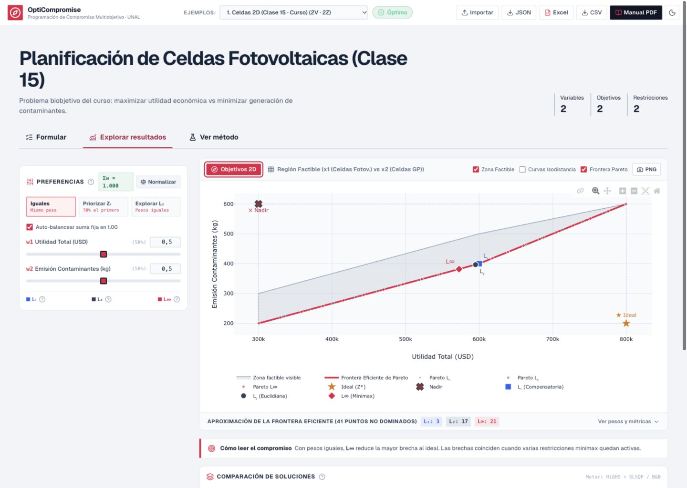
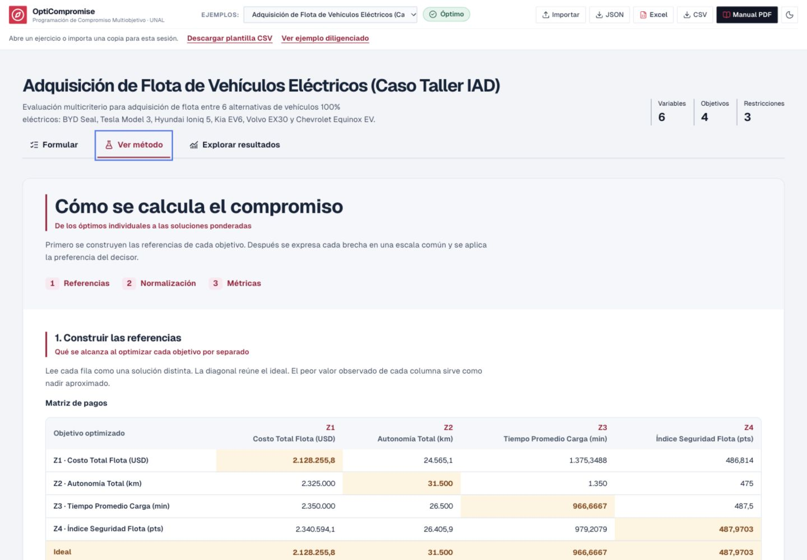

# Guía de la interfaz actual

## Formular un modelo

1. Elige un ejemplo o **Nuevo Modelo en Blanco** en la barra superior. **Importar** abre un archivo de OptiCompromise.
2. En **Formular**, define las variables, sus cotas y tipo. Agrega los objetivos e indica qué se debe maximizar o minimizar.
3. Introduce las restricciones con ≤, ≥ o =. Puedes escribir los coeficientes en la tabla o trabajar en **Modo Algebraico** y aplicar el texto. La vista matemática muestra el modelo que resolverá el motor.
4. Pulsa **Resolver** para ir a la comparación. Si el modelo es infactible, revisa qué restricciones y cotas pueden resultar incompatibles. Si está no acotado, revisa qué objetivo puede mejorar indefinidamente.

## Explorar e interpretar

1. En **Preferencias**, mueve los deslizadores para expresar la importancia de cada objetivo. El balance automático ajusta los otros pesos para conservar la suma 1.
2. En el gráfico, identifica el ideal, el nadir de referencia y las tres soluciones. Elige **Región factible** para dos variables o **Espacio 3D** para tres o más objetivos.
3. En un modelo de dos objetivos, abre **Sensibilidad de pesos** para comparar la desviación al ideal de L₁, L₂ y L∞. La línea punteada sigue el peso seleccionado. Los marcadores grandes corresponden al último cálculo del motor. **PNG** exporta los tres paneles juntos.
4. En **Comparación de soluciones**, revisa qué gana y qué cede cada objetivo. Consulta la tabla de variables para traducir la solución a decisiones concretas.
5. En **Ver método**, usa el índice para saltar a Referencias, Normalización o Métricas. La matriz de pagos incluye el ideal y el nadir como filas de referencia. Las fórmulas principales están visibles. Abre las consultas avanzadas para ver la matriz normalizada o cada restricción minimax con sus coeficientes.
6. Guarda el modelo con **JSON**. Exporta el cálculo a **Excel** o **CSV** y descarga el gráfico visible con **PNG**.

| Concepto | Lectura |
|---|---|
| Ideal | Vector con el mejor valor de cada objetivo, calculado por separado. |
| Nadir aproximado | Peor valor de cada criterio entre las filas de la matriz de pagos. |
| Logro | 100% en el ideal y 0% en el nadir de referencia. Puede ser negativo si una solución queda por debajo de esa referencia. |
| Frontera aproximada | Alternativas de la muestra para las que ninguna otra de la muestra mejora un criterio sin empeorar otro. |
| L₁ / L₂ / L∞ | Suma de brechas ponderadas, suma ponderada de brechas al cuadrado y mayor brecha ponderada, respectivamente. La distancia L₂ mostrada incluye la raíz cuadrada. |
| Resultado parcial | Alguna métrica quedó sin verificación de optimalidad. Si existe un candidato factible, la aplicación lo identifica como tal. |

## Capturas del recorrido

**Explorar resultados en escritorio.** El espacio de objetivos muestra la región proyectada, el ideal, el nadir, la frontera aproximada y las tres soluciones. Las preferencias se pueden modificar sin abandonar el gráfico.

**Ver método.** La matriz de pagos muestra qué se consigue al optimizar cada criterio por separado. Debajo se usa el rango de referencia para comparar unidades distintas.

**Modelo triobjetivo.** Selecciona **Espacio 3D** para girar el gráfico y ver la relación entre los tres criterios.

[Vista móvil de 390 px después de usar Ir al gráfico](capturas/opticompromise-movil.jpg)
